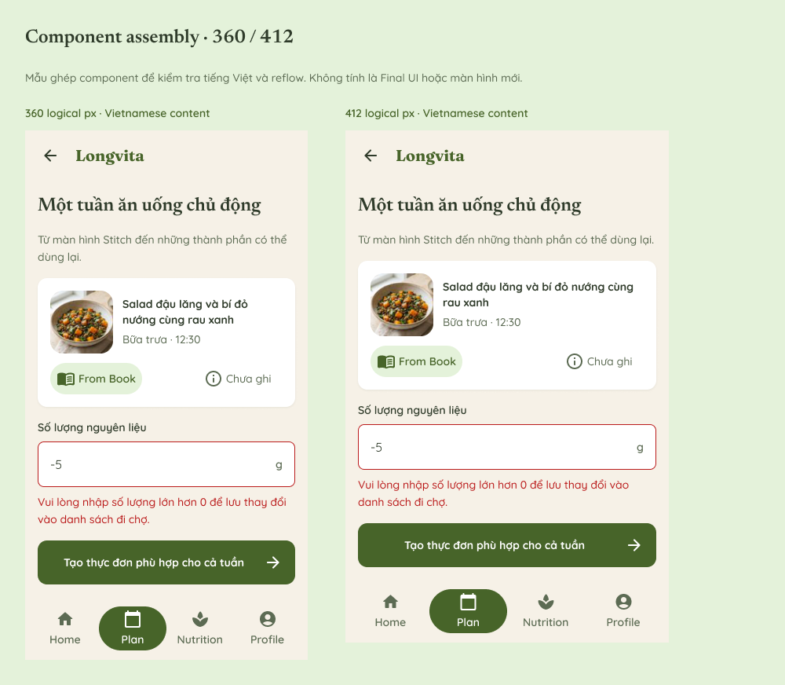

# Longvita Design System — Member 2

Thư viện Figma được xây từ ba màn Stitch leader cung cấp: **S01 Home Dashboard, S03 Create Meal Plan, S04 Weekly Meal Plan**. Phạm vi Member 2 là foundations và components để nhóm dùng lại; mười Final UI và prototype ứng dụng thuộc phần việc khác.

- [Page 04 — Design System](https://www.figma.com/design/73GTcipwH825N7l501or8D/Longvita---UI-UX-Design?node-id=53-2)
- [Page 05 — Component Catalog](https://www.figma.com/design/73GTcipwH825N7l501or8D/Longvita---UI-UX-Design?node-id=58-153)
- [Mẫu ghép 360/412](https://www.figma.com/design/73GTcipwH825N7l501or8D/Longvita---UI-UX-Design?node-id=58-711)
- [Hướng dẫn sử dụng và demo Member 2](../docs/member-2-design-system-guide.md)
- [Nguồn Stitch của leader](../assets/stitch/leader-export/) · [Danh mục nguồn](stitch-source-inventory.json)

## Nguồn và lựa chọn thiết kế

Giữ nền kem, xanh olive, card trắng, headline serif và nội dung sans-serif. HTML của ba màn dùng nút `#476429` với chữ trắng; đây là màu hành động được chọn. `#6F8F4E` trong DESIGN.md gốc được giữ làm brand primitive. Nhãn nhỏ được chuẩn hóa lên 14; các trạng thái bổ sung dùng cùng ngôn ngữ thị giác. Dialog và Empty/Error là phần bổ sung theo phân công, không phải toàn bộ đều có trong ZIP.

## Foundations — Page 04

Color dùng semantic variables; typography và elevation dùng Styles. Bản inventory ngày 20/10/2026 có **64 variables / 3 collections**: Primitives 20, Color 23, Metrics 21. Đây là baseline trong [design-system-tokens.json](design-system-tokens.json), không phải export live của mọi thay đổi sau đó; không cộng token thử nghiệm từ sandbox vào file chính.

| Vai trò | Token | Giá trị |
|---|---|---|
| Nền trang / card | color/bg/canvas · color/bg/surface | #F6F1E7 · #FFFFFF |
| Nền chọn | color/bg/selected | #E4F2DA |
| Chữ chính / phụ | color/text/primary · color/text/secondary | #2F3B2A · #5C6B53 |
| Hành động / đang nhấn | color/action/primary · color/action/pressed | #476429 · #324E15 |
| Chữ trên nút chính | color/action/on-primary | #FFFFFF |
| Viền control | color/border/control | #74796C |
| Lỗi | color/feedback/error | #BA1A1A |

Tương phản tính từ màu đặc: chữ trắng trên nút xanh khoảng 6.72:1; chữ chính trên nền kem 10.48:1; chữ phụ 5.06:1. Đây là tỷ lệ của các cặp màu, không phải chứng nhận accessibility toàn ứng dụng.

| Text Style | Font / weight | Size / line height |
|---|---|---|
| Longvita/Brand | Fraunces Bold | 20 / 28 |
| Longvita/Heading/L | Newsreader Bold | 28 / 36 |
| Longvita/Heading/M | Newsreader SemiBold | 24 / 32 |
| Longvita/Title | Newsreader SemiBold | 20 / 28 |
| Longvita/Body | Quicksand Regular | 16 / 26 |
| Longvita/Supporting | Quicksand Medium | 14 / 22 |
| Longvita/Label | Quicksand SemiBold | 14 / 20 |
| Longvita/Label/Strong | Quicksand Bold | 14 / 20 |

- Spacing minh họa: 4, 8, 12, 16, 24, 32, 48. Page margin 16, card padding 16–24, icon 24, vùng chạm mục tiêu tối thiểu 48×48.
- Page 04 hiện minh họa radius 4/8/12/16/full. Inventory token20/10 còn danh mục radius cũ; xem giá trị đang bind trên component khi ghép màn, không coi tên mẫu radius là bằng chứng binding. Điểm này cần thống nhất khi nhóm chỉnh thư viện, không tự sửa file nguồn trong đợt chốt demo.
- Effect Styles: Elevation/0 phẳng; Elevation/1 shadow 0/1, blur 3, alpha 0.08; Elevation/2 shadow 0/4, blur 16, alpha 0.12, cùng màu #2F3B2A.
- Bản chính dùng token `size/button/height = 52`; Button có icon 24 và padding 16 cao thực tế 56. Khi ẩn icon, chiều cao có thể còn 52. Fix minimum56 đã thử riêng, **chưa áp dụng vào file chính**; demo dùng các instance có sẵn với icon.

## Components — Page 05

| Nhóm bắt buộc | Variants trong file chính | Số lượng |
|---|---|---:|
| Button | Primary/Secondary/Destructive × Default/Pressed/Disabled/Loading | 12 |
| TextField | Default/Focused/Filled/Error/Disabled | 5 |
| Card | Meal/Summary × Default/Pressed | 4 |
| Navigation | Home/Plan/Nutrition/Profile selected | 4 |
| AppBar | Default/WithActions | 2 |
| Dialog | Confirmation/Destructive/Error/Edit/EditError | 5 |
| Loading | Spinner/Skeleton | 2 |
| Empty | NoPlan/NoIngredients/NoAlternatives | 3 |
| Error | Generation/Save/Update | 3 |

**9 nhóm, 40 variants**. Catalog là các instances; component gốc nằm cùng Page 05. IconButton, Badge, NavigationItem, DaySelector, CheckboxRow, Snackbar và QuantityStepper là thành phần hỗ trợ.

Chọn variant theo ngữ cảnh rồi sửa Label/Title/Description/Value qua properties hoặc text overrides. Với TextField/Error, sửa text layer `Error message`. Không detach để đổi nội dung, không dùng PNG thay component, không sửa main component trong lúc demo. Profile là nhãn tham chiếu từ Stitch; nhóm chưa có màn riêng trong inventory S01–S10.

## Kiểm tra nhanh phục vụ demo — 21/10/2026

Đã đọc metadata file chính: Page 04 và Page 05 hiện diện, đủ 9 nhóm với 40 variants; các mẫu Button, TextField, Card và Navigation trong catalog/mẫu 360/412 là instances. Đã xem ảnh xuất hiện tại của foundations, catalog và mẫu 360/412; không thấy lỗi hiển thị rõ ràng cản demo ở các mẫu này. [Kết quả kiểm tra gọn](design-system-verification.json).

Lượt này chỉ đọc Figma, không đổi token/property, không thử hết tương tác và không tiếp tục QA chuyên sâu. Các tình huống đổi icon rồi chuyển Loading hoặc đổi Emphasis giữa variants chưa được đóng; demo bằng các instance đã chuẩn bị, không công bố chúng đã nghiệm thu tương tác toàn bộ. Quyền xem bằng tài khoản giảng viên/ẩn danh cần leader kiểm tra trước buổi trình bày.

## Handoff cho nhóm

Member 3 dùng Assets hoặc copy instance từ Catalog vào màn hình. Dùng màu semantic, Text Styles và Auto Layout đang có; phản hồi thay đổi quy chuẩn về Member 2. Token-to-Flutter dự kiến là ColorScheme/TextTheme/constants; components tương ứng FilledButton, TextFormField, Card, NavigationBar, AppBar, Dialog. Đây là định hướng, chưa có Flutter implementation hoặc Code Connect. Screen specs và Flutter handoff đầy đủ thuộc Member 4.
