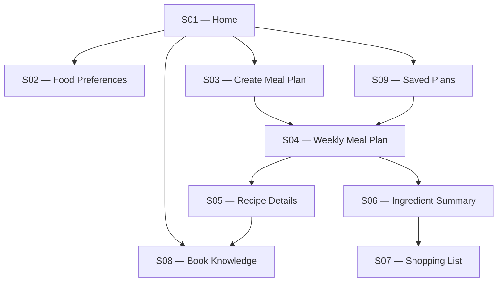
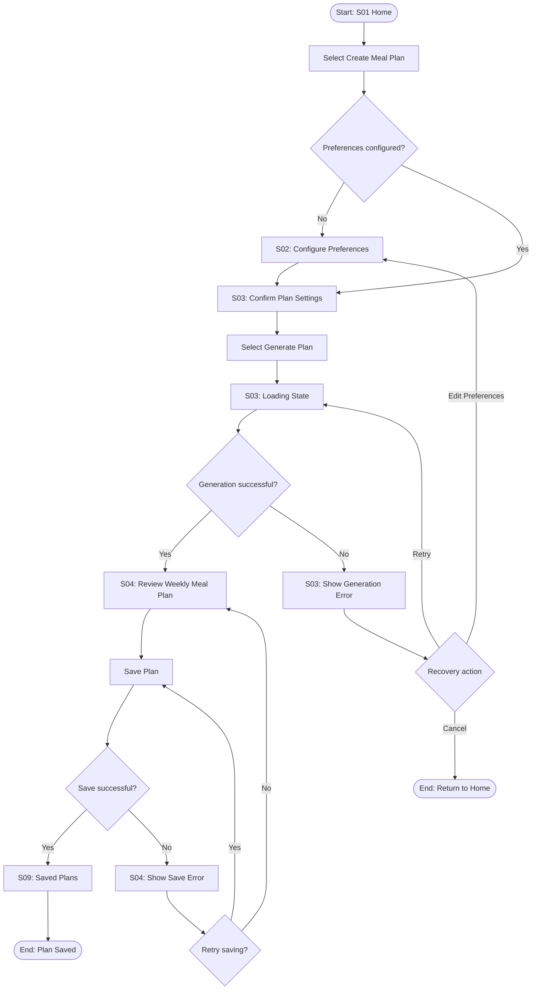
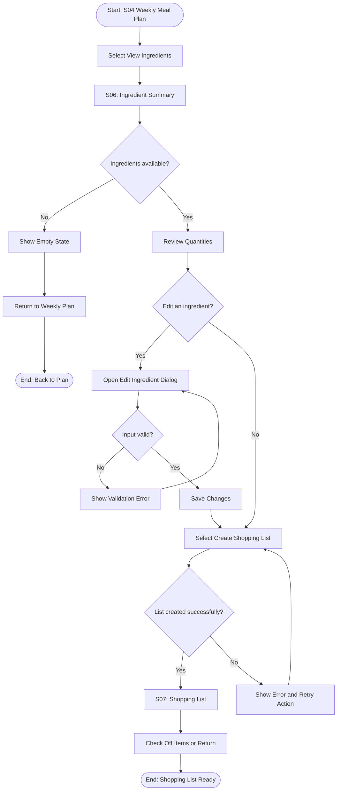
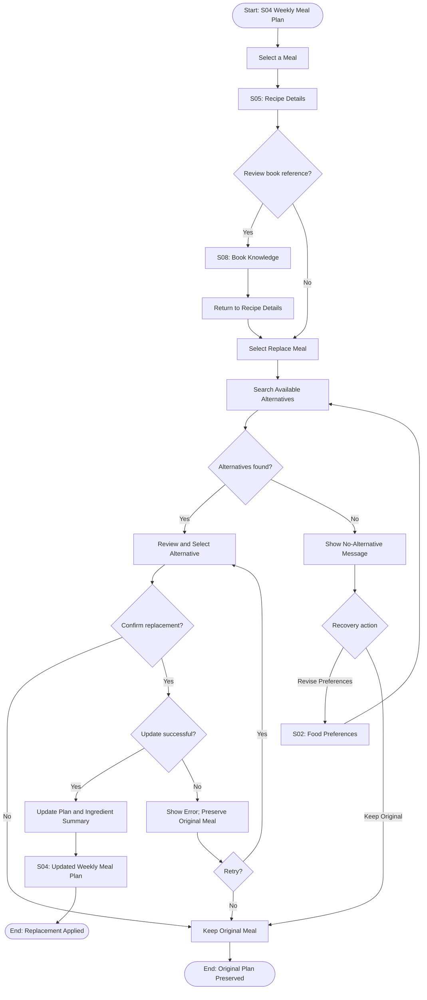

# Book to App — Information Architecture & User Flow

**Course:** PRM323 — Lab 2: AI-Assisted UI/UX Design  
**Platform:** Mobile application  
**Document:** UX Analysis

## 1. Information Architecture

### 1.1. Screen Inventory

| ID | Screen | Navigation level | Purpose |
|---|---|---|---|
| S01 | Home | Top-level | Điểm vào ứng dụng để bắt đầu lập kế hoạch bữa ăn. |
| S02 | Food Preferences | Onboarding / Nested | Thiết lập tuổi &lt;65 hay ≥65, cân nặng tính đạm 0.8g/kg, số bữa 2 hoặc 3 bữa/ngày, khung giờ ăn 12h. |
| S03 | Create Meal Plan | Nested | Chọn chu kỳ 7 ngày, kiểm tra giới hạn 2–3 bữa cá/tuần. |
| S04 | Weekly Meal Plan | Main destination | Xem thực đơn 7 ngày, kèm trạng thái Generating/Loading state chuyển sang kết quả. |
| S05 | Recipe Details | Nested | Xem công thức, định lượng nguyên liệu, nhãn phân biệt "Từ sách Phụ lục A" vs "App gợi ý". |
| S06 | Meal Alternatives | Nested | Danh sách món ăn/nguyên liệu thay thế tương đương đúng chuẩn sách, VD đổi pasta sang gạo hoang/farro. |
| S07 | Ingredient Summary | Nested | Tổng hợp nguyên liệu cả tuần, tích hợp Edit Ingredient Dialog Overlay. |
| S08 | Shopping List | Main destination | Danh sách đi chợ phân nhóm Rau củ, Đậu, Hạt & Dầu ô liu, Cá. |
| S09 | Book Knowledge | Main destination / Nested detail | Tra cứu 5 trụ cột trường thọ & quy tắc dinh dưỡng từ sách được gắn vào từng món ăn. |

**Screen-count rule:** The inventory contains nine distinct screen designs. Loading, error, empty, confirmation, and editing states are designed as states or overlays of their parent screens and are not counted as separate screens.

### 1.2. Navigation Structure

### 1.3. Navigation Rules

1. Home provides access to all primary destinations.
2. Users can create a meal plan with existing preferences or configure preferences before generation.
3. A successful generation opens the Weekly Meal Plan screen.
4. Users can save a plan and access it later through Saved Plans.
5. Recipe Details provides access to relevant book references through Book Knowledge.
6. Ingredient Summary leads to Shopping List.
7. Editing an ingredient opens an editing dialog or inline editor within the relevant screen; it does not create an additional screen.
8. Loading, empty, and error states must provide clear next actions and recovery options.

## 2. User Flow 1 — Create and Save a Weekly Meal Plan

**Start:** S01 — Home  
**Goal:** Generate and save a suggested seven-day meal plan.  
**End:** S09 — Saved Plans, with the newly saved plan available.

### Happy Path

1. The user opens Home.
2. The user selects Create Meal Plan.
3. If preferences are not configured, the user completes S02.
4. The user confirms the planning settings in S03.
5. The user selects Generate Plan.
6. S03 displays its loading state while the application processes the request.
7. On success, S04 displays the weekly meal plan.
8. The user reviews the plan and selects Save Plan.
9. The application saves the plan and confirms the result.
10. The user opens Saved Plans and sees the newly saved plan.

### Alternative and Recovery Paths

- Existing preferences: skip preference setup.
- Generation failure: display an error state on S03, with Retry and Back actions.
- No suitable result: allow the user to revise preferences and try again.
- Save failure: preserve the generated plan on screen and offer Retry.
- User cancels: return to the previous screen without reporting an unsuccessful operation as completed.

### Flow Diagram

## 3. User Flow 2 — Generate and Manage a Shopping List

**Start:** S04 — Weekly Meal Plan  
**Goal:** Consolidate ingredients from the selected plan and prepare a shopping list.  
**End:** S07 — Shopping List, with the list ready to use.

### Happy Path

1. The user opens a weekly meal plan.
2. The user selects View Ingredients.
3. S06 displays the ingredients required by the selected plan.
4. The application consolidates duplicate ingredients where their units are compatible.
5. The user reviews quantities and optionally opens the Edit Ingredient dialog.
6. The user saves valid changes.
7. The user selects Create Shopping List.
8. S07 displays the consolidated shopping list.
9. The user checks off purchased ingredients or returns to the weekly plan.

### Alternative and Recovery Paths

- No plan available: provide a route to create a plan.
- Empty ingredient result: show an empty state with an action to return to the plan.
- Invalid quantity: keep the dialog open, explain the validation error, and allow correction.
- Ingredient removed accidentally: provide Undo when appropriate.
- List creation failure: retain the ingredient summary and allow the user to retry.

### Flow Diagram

## 4. User Flow 3 — Review Book Knowledge and Replace a Meal

**Start:** S04 — Weekly Meal Plan  
**Goal:** Review a meal's details and related book information, then replace the meal if needed.  
**End:** S04 — Weekly Meal Plan, with the replacement applied or the original meal preserved.

### Happy Path

1. The user opens the weekly plan.
2. The user selects a meal to open S05.
3. The user reviews the recipe and selects its related book reference.
4. S08 displays the relevant book-related information.
5. The user returns to S05.
6. The user selects Replace Meal.
7. The application searches its available recipes using the user's configured preferences.
8. The user selects and confirms an alternative.
9. The application updates the weekly plan and recalculates its ingredient summary.
10. S04 displays the updated plan.

### Alternative and Recovery Paths

- No alternatives found: explain the result and allow the user to keep the original meal or revise preferences.
- Search failure: show an error with Retry.
- User rejects alternatives: return to the original recipe without changing the plan.
- Update failure: preserve the original meal and allow the user to retry.
- Book reference unavailable: explain that a source reference is unavailable and allow the user to return to the recipe.

### Flow Diagram

## 5. Flow-to-Screen Mapping

| Flow | Screens used | Main outcome |
|---|---|---|
| Flow 1 — Create and save a weekly meal plan | S01, S02, S03, S04, S09 | A weekly plan is generated and saved, or the user receives a recovery option. |
| Flow 2 — Generate and manage a shopping list | S04, S06, S07 | A consolidated shopping list is ready to use. |
| Flow 3 — Review book knowledge and replace a meal | S02, S04, S05, S08 | The user can inspect book-related information and replace a meal, or preserve the original plan. |

**Coverage:** All nine screens appear in at least one flow. The ingredient-editing dialog and the loading, empty, and error states belong to their parent screens and are not counted as distinct screens.

